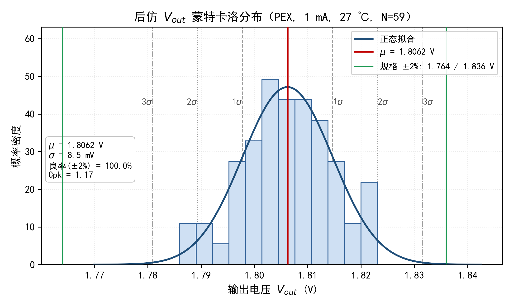

# SMIC 0.13 μm RF CMOS LDO 设计

一款面向片上系统供电的低压差线性稳压器（Low Dropout Regulator）完整设计，覆盖电路架构、版图、DRC/LVS/xRC 寄生提取、前后仿真与蒙特卡洛分析。

- **工艺**：SMIC 0.13 μm 1P6M RF CMOS（1.8 V 核心 n33/p33 + 厚氧化层 3.3 V 器件）
- **工具链**：Cadence Virtuoso / Spectre / Calibre
- **输入 / 输出**：3.3 V → 1.8 V，最大负载 500 mA
- **完整报告**：[LDO_Design_Report_SMIC130nm.pdf](LDO_Design_Report_SMIC130nm.pdf)（21 页）

## 电路结构

LDO 为电压串联负反馈系统，输出经反馈分压网络得到 VFB，与基准电压一起送入误差放大器，放大后驱动 PMOS 功率调整管栅极，将 Vout 稳定在设定值。

| 模块 | 说明 |
| --- | --- |
| β-multiplier 带隙基准 | 提供与温度、电源弱相关的参考电压 |
| 差分误差放大器 | 决定环路增益与调整精度 |
| PMOS 功率调整管 | 源极接 VDD，低 dropout 工作 |
| 反馈分压网络 | 设定输出 1.8 V，可修调 |
| 启动电路 | 摆脱简并零电流工作点 |
| 过流保护（OCP） | 折返式限流，旁路钳位 EA 输出 |
| 过温保护（OTP） | 结温超限时关断功率管 |

保护电路均以“旁路式”接入，不参与主环路，正常工作时对环路无影响。

## 设计指标与后仿结果

| 指标 | 符号 | 设计目标 | 后仿结果 |
| --- | --- | --- | --- |
| 输入电压 | Vin | 3.3 V | 3.3 V |
| 输出电压 | Vout | 1.8 V | 1.8061 V（+0.34%） |
| 最大输出电流 | Iout,max | ≥ 500 mA | 500 mA 满载稳压 |
| 输出电压精度 | δ | ≤ 2%（全温区） | +0.23% ~ +0.34% |
| 温漂系数 | — | — | 7.0 ppm/℃ |
| 静态电流 | Iq | ≤ 80 μA | 72.2 μA @ 27 ℃ |
| 电源抑制比 | PSRR | ≥ 80 dB @ 1 kHz | 85.1 dB @ 1 kHz |
| 限流点 | — | 具备 OCP | ≈ 575 mA（折返） |
| 过温保护 | OTP | 具备 | 142.2 ℃ 触发 |
| 负载调整率 | — | 小 | 重载下受金属寄生影响 |

## 后仿蒙特卡洛

在 Calibre PEX 提取的寄生网表上做蒙特卡洛，模型同时开启工艺偏差与器件失配（`variations=all`），固定随机种子，共抽样 60 次；负载 1 mA、温度 27 ℃。

- 60 次抽样中 **59 次收敛**到正常调节点，另 1 次直流求解落入启动电路简并解（Vout 被拉高至 3.29 V），属数值收敛问题，已剔除。
- 有效样本 59 个：均值 **1.8062 V**，标准差 **8.46 mV**（1σ 相对偏差 0.47%），取值区间 1.7860 ~ 1.8231 V，极差 37.2 mV，μ±3σ = 1.7808 ~ 1.8316 V。
- 按 1.8 V ±2%（1.764 ~ 1.836 V）判据，全部有效样本落在规格内，**统计良率 100%，Cpk = 1.17**；Cpk 偏低主要来自均值偏离中心，而非分散度大。



逐次抽样数据见 [MonteCarlo_Vout_Data.csv](MonteCarlo_Vout_Data.csv)（`run, Vout` 两列，按 Vout 升序，已剔除 1 个伪解）。

## 已知不足与改进方向

1. 125 ℃ 高温下静态电流升至 92.6 μA，超出 80 μA 指标，需优化偏置支路高温漏电。
2. 重载（500 mA）时 PSRR 仅 37 dB，需加强功率管栅极的电源纹波抑制。
3. 版图金属寄生使负载调整率恶化、限流点提前，可通过加宽电源/地金属与优化采样支路改善。
4. 对分压电阻做少量修调可把 Cpk 提升至 2 以上。

## 目录

```
.
├── LDO_Design_Report_SMIC130nm.pdf   # 设计报告（21 页，含版图、前后仿、蒙特卡洛）
├── MonteCarlo_Vout_Histogram.png     # 后仿 Vout 蒙特卡洛直方图
├── MonteCarlo_Vout_Data.csv          # 59 次有效抽样数据
└── README.md
```

## 说明

本仓库仅包含设计报告与仿真数据。工艺库（SMIC 0.13 μm PDK）与 Virtuoso 工程文件因授权限制不随仓库分发。
